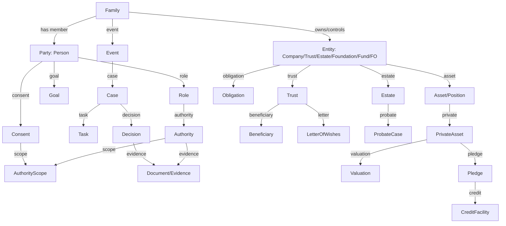

# 01 — Capability & Data Model：能力域与数据模型

> 本文件把“能力模型”和“数据模型”合并为一份：先看 C01–C12 + X1/X2 的能力地图，再看支撑它的实体、事件、证据与不变量。
> 架构图见 [`README.md`](README.md)；Avaloq 边界与商业论证见 [`02-avaloq-boundary-and-business-case.md`](02-avaloq-boundary-and-business-case.md)。

## 本文件结构

| 节 | 回答什么 | 原文件（已合并） |
|---|---|---|
| A | 一个主键、六个事实、十二域、X1/X2、优先级、不做什么 | `01-core-capability-model.md` |
| B | 十二组核心实体、事件/证据、as-of、迁移映射、不变量 | `03-data-model.md` |

---

## A. 能力模型：C01–C12 + X1/X2

<!-- source: 02-functional-architecture/01-core-capability-model.md -->

> 这是 v2.0 的“能力地图”，不是页面清单。页面与 solution map 在 [`03-solution-map.md`](03-solution-map.md)，旅程在 [`../01-user-journey/`](../01-user-journey/README.md)。
> 目标：把 Ida Liu 的“家族/代际/治理/跨境”战略，变成可建设、可验收、可衡量的核心能力。

---

### 0. 一句话

> **一个主键（Family）+ 六个事实（Party/Authority/Goal/Event/Asset/Evidence）+ 十二个能力域。**
> 主键不是 `client_id`，也不是 `account_id`；是“家族—法律主体—角色—授权—事件—证据”的图。

---

### 1. 能力分层

| 层 | 能力 | 事实源 |
|---|---|---|
| **基础层** | 家族图、法律主体、角色、授权、同意、产品、资产、文档、证据 | 自研新核心（参考 Avaloq 能力） |
| **生命周期层** | 目标、事件、旅程、家族治理、下一代、家办、跨境 | 新核心 |
| **财富层** | 投资、交易、托管、信贷、私股、信托/遗产、慈善 | 自研新核心 + 合作 |
| **控制层** | 税务、合规、制裁/PEP、适当性、Chinese Wall、欺诈 | 自研新核心 + 合作 |
| **体验层** | RM cockpit、家族 portal、下一代 app、家办 dashboard | 新核心 + 合作 |
| **衡量层** | 家族价值、钱包份额、下一代激活、留存、转介 | 新核心 + 财务 |

---

### 2. C01 家族与法律主体（Family & Legal Entity Master）

#### 2.1 回答的问题

- 这个家族有哪些人、公司、信托、遗产、基金、家办？
- 谁是谁的配偶/子女/父母/分支？
- 哪个实体持有哪个资产？谁控制？谁受益？
- 哪个是法律主体，哪个只是服务视图？

#### 2.2 功能

| 功能 | 说明 |
|---|---|
| 家族图 | 人/分支/代际/婚姻/子女/收养/监护；不是一棵树，是图 |
| 法律主体 | Person/Company/Trust/Estate/Foundation/Fund/FamilyOffice |
| 关系 | 家庭/经济/控制/受益/服务/授权 |
| 受益所有权 | 直接/间接/控制/受益；UBO |
| 控制权 | 投票/董事任命/保护人/否决/罢免 |
| 合并视图 | 家族/分支/实体/家办；可按 consent 聚合 |
| 数据来源 | KYC/KYB、客户提供、公开文件、律师/信托、Avaloq BP/REL 迁移映射 |

#### 2.3 对象

`Family`、`Party`、`Person`、`Company`、`Trust`、`Estate`、`Foundation`、`Fund`、`FamilyOffice`、`Relationship`、`Ownership`、`ControlRight`、`BeneficialOwner`、`Household`（服务视图）。

#### 2.4 系统

- 新核心：family/entity graph、ownership/control、consolidation。
- Avaloq 仅作为迁移映射参考：`OBJ_BP`/`OBJ_PERSON`/`OBJ_CONT`/`OBJ_PERSON_REL2`/`OBJ_BP_PERS_REL_AUTH`。
- 外部：KYC/KYB、公司注册、信托文件、律师。

#### 2.5 指标

家族覆盖率、实体完整率、UBO 完整率、跨实体合并率、数据冲突率。

> 注意：Avaloq 的 `OBJ_PERSON_REL2` 能记录关系/参与/代表，但不是“家族树/UBO 引擎”；源码审计明确“没有通用 25% UBO 阈值/自动最终自然人穿透/家庭继承签字权”。所以这是新核心，不是 Avaloq 字段扩展。

---

### 3. C02 角色、授权与同意（Roles, Authority & Consent）

#### 3.1 回答的问题

- 谁现在能查看/交易/支付/披露/分配？
- 依据哪份文件？生效/失效？哪个辖区？登记了吗？
- 客户同意了什么？给谁看？什么目的？能撤回吗？
- 死亡/失能/争议/制裁时，权限怎么变？

#### 3.2 功能

| 功能 | 说明 |
|---|---|
| 角色 | founder/spouse/next-gen/beneficiary/trustee/protector/attorney/executor/deputy/FO CEO/CIO/advisor/RM |
| 授权 | POA/EPA/LPA/deputy/trustee/executor/corporate signatory/investment mandate |
| 范围 | 账户/资产/金额/交易类型/时间/辖区/目的 |
| 生效/失效 | 签署/登记/法院/死亡/失能/撤回/到期 |
| 同意 | 数据共享/营销/跨实体/第三方/未成年人 |
| 冲突 | 角色冲突/家族分支/商业关系/Chinese Wall |
| 证据 | 文件/登记/法院命令/送达/批准 |

#### 3.3 对象

`Role`、`Authority`、`AuthorityScope`、`AuthorityStatus`、`Consent`、`Restriction`、`ConflictRegister`、`CourtOrder`、`CapacityEvent`、`DeathEvent`。

#### 3.4 系统

- 新核心：authority graph/consent/conflict/evidence。
- 自研新核心：授权/支付/交易执行；Avaloq 仅参考其授权字段。
- 外部：法院/登记机构/律师/医疗。

#### 3.5 指标

授权核验时间、0 无权支付、0 越权披露、同意覆盖率、冲突识别率、证据完整率。

> 注意：HSBC UK 的 POA 权限矩阵是现实锚点：general POA 不能管理失能后账户；joint attorneys 不能用网银/手机银行；arrange an overdraft 对所有 POA 都是 No。系统必须表达“不能做什么”，不是只表达“能做什么”。

---

### 4. C03 目标、事件与旅程（Goals, Events & Journeys）

#### 4.1 回答的问题

- 这个家族/成员的目标是什么？教育/创业/买房/退休/慈善/传承？
- 下一步是什么事件？时间/金额/币种/责任人？
- 现在走到哪？成功/失败/需要什么？

#### 4.2 功能

| 功能 | 说明 |
|---|---|
| 目标 | 教育/住房/创业/退休/流动性/慈善/传承 |
| 目标四元组 | 提出人/受益人/出资方/决策人 |
| 事件 | 出生/入学/毕业/婚姻/搬迁/创业/融资/IPO/退出/死亡/失能/离婚/制裁 |
| 旅程 | S1–S5 阳光；X1–X5 压力 |
| 里程碑 | 金额/日期/状态/证据 |
| 现金流 | 10 年/30 年；币种/通胀/税 |
| 复盘 | 年度/事件后 |

#### 4.3 对象

`Goal`、`GoalFunding`、`LifeEvent`、`Journey`、`Milestone`、`CashflowPlan`、`AnnualReview`。

#### 4.4 系统

自研新核心；与自研账本/支付、Aladdin 情景、TFS 信托预算、税务数据包集成。

#### 4.5 指标

目标达成率、补充率、事件完成时间、客户参与度、下一代参与。

---

### 5. C04 家族治理与下一代（Family Governance & NextGen）

#### 5.1 回答的问题

- 家族怎么一起做决定？谁有话语权？冲突怎么解决？
- 下一代准备好了吗？需要教育/导师/实践？
- 家族宪章/委员会/接班计划在哪？

#### 5.2 功能

| 功能 | 说明 |
|---|---|
| 家族宪章 | 价值观/决策/ employment/分配/慈善 |
| 家族理事会 | 代表/分支/职责/会议 |
| 下一代计划 | 教育/导师/独立账户/投资委员会观察/创业/慈善 |
| 学习记录 | MIT/Athens/内部课程/完成/主题 |
| 接班 | 企业/家办/信托/慈善 |
| 冲突 | 调解/规则/证据 |
| 慈善 | 基金会/ grant/ impact |

#### 5.3 对象

`FamilyCharter`、`FamilyCouncil`、`GovernancePolicy`、`NextGenPlan`、`LearningRecord`、`Mentorship`、`SuccessionPlan`、`FamilyMeeting`、`ConflictCase`。

#### 5.4 系统

新核心 + 合作（MIT/Athens/TFS/调解/教练）。不是“活动管理”，是“治理/学习/接班”的记录与触发。

#### 5.5 指标

课程完成率、下一代独立账户、首投、家族会议、宪章完成、接班计划、冲突解决。

---

### 6. C05 家族办公室（Family Office Operating System）

#### 6.1 回答的问题

- 家办怎么运营？谁做什么？成本多少？
- 合并报表/投资/风险/信贷/信托/税务/慈善怎么协同？
- 家办与银行/CIB/外部顾问怎么分工？

#### 6.2 功能

| 功能 | 说明 |
|---|---|
| 家办画像 | SFO/MFO、规模、辖区、团队、服务范围 |
| 合并报表 | 银行/外部/信托/私股/房产/收藏品 |
| 投资政策 | IPS/SAA/TAA/风险/流动性/集中度 |
| 运营 | 预算/费用/供应商/cyber/合规 |
| 银行服务 | 托管/信贷/外汇/私股/信托/慈善 |
| CIB | 并购/融资/资本市场/HSBC Access |
| 治理 | 家族 vs 家办 vs 银行的责任 |

#### 6.3 对象

`FamilyOffice`、`FOServiceModel`、`ConsolidatedView`、`InvestmentPolicy`、`FOBudget`、`FOVendor`、`FOStaff`、`FOReport`。

#### 6.4 系统

新核心 + Addepar/Aladdin + TFS + CIB + 外部托管。

#### 6.5 指标

家办 AUA、合并覆盖率、投资政策合规、成本/收入、服务渗透、下一代参与。

> 判断：家办不是“更富的私行客户”；它是“机构化运营 + 家族治理”。用私行页面硬套会失败。

---

### 7. C06 投资与顾问（Investment & Advisory）

#### 7.1 功能

| 功能 | 说明 |
|---|---|
| 目标/约束 | 收益/风险/流动性/集中度/币种/ESG/限制 |
| IPS | 政策区间/基准/再平衡 |
| 提案 | 三套方案/成本/税/时间/冲击/可执行性 |
| 适当性 | 产品/客户/风险/经验 |
| 组合 | 配置/风险/压力/回测 |
| 顾问 | RM/IC/专家协作 |
| 复盘 | 实际 vs 目标/TCA/归因 |

#### 7.2 对象

`InvestmentPolicy`、`Proposal`、`Suitability`、`Portfolio`、`Allocation`、`RiskProfile`、`Performance`、`TCA`。

#### 7.3 系统

自研新核心（持仓/交易/会计，参考 Avaloq 能力）+ Aladdin（风险/情景）+ 新核心（目标/提案/证据）。

#### 7.4 指标

提案周期、目标达成、成本、税后、适当性、客户 NPS。

---

### 8. C07 交易、托管与账本（Trading, Custody & IBOR）

#### 8.1 功能

订单/路由/执行/结算/托管/公司行动/现金/GL/对账/绩效/费用。

#### 8.2 系统

**Avaloq 强项**：`DOC_STEX`、`DOC_SETTLE`、`BALSTRU_CALC#MV`、`BE_BOOK#PUT`、`PERF_CALC#TWRR/MWRR`、`TASK_FEE`、`FREEZE_SPOT`、`NETW_SWIFT`、AFS。

#### 8.3 判断

自研重写；Avaloq 仅作能力参考和迁移来源，不续订。Avaloq 的 22,455 procedures、58.4% workflow/task、26.7% integration、14.9% core 说明其领域复杂度；自研必须分阶段迁移/双跑，不能大爆炸。

---

### 9. C08 流动性、信贷与私股（Liquidity, Credit & Private Markets）

#### 9.1 功能

| 功能 | 说明 |
|---|---|
| 流动性诊断 | 纸面/可质押/可花费；90 天/1 年/5 年 |
| 标准信贷 | Lombard/房贷/结构化 |
| 私股质押 | 估值/折扣/LTV/质押/登记/执行 |
| Pre-IPO | 融资轮/lock-up/IPO 窗口/静默期/老股/secondary/forward |
| Capital call | 承诺/调用/分配/NAV |
| 义务日历 | capital call/earn-out/vendor loan/税/利息 |
| 追保 | 估值/覆盖率/通知/补仓/处置 |
| 退出 | IPO/增发/secondary/接续基金/老股 |

#### 9.2 对象

`LiquidityPlan`、`CreditFacility`、`Collateral`、`Pledge`、`LTV`、`Covenant`、`MarginCall`、`PrivateAsset`、`Valuation`、`ValuationGovernance`、`CapitalCall`、`Distribution`、`ExitScenario`、`InsiderWindow`。

#### 9.3 系统

自研新核心（标准信贷/抵押/额度/追保，参考 Avaloq COLLAT/LIHI）+ 新核心（私股生命周期/估值治理/义务/证据）+ 合作（估值/法律/投行）。

#### 9.4 指标

可决策包时长、估值复核、质押登记、追保准确、义务覆盖、退出执行。

---

### 10. C09 信托、遗产与保险（Trust, Estate & Insurance）

#### 10.1 功能

| 功能 | 说明 |
|---|---|
| 信托 | 契约/意愿书/受托人/保护人/受益人/分配 |
| 遗产 | will/executor/probate/letters/estate account |
| 跨境 | grant/reseal/承认/执行 |
| 保险 | 寿险/重疾/年金/流动性 |
| 慈善 | 慈善信托/基金会/grant/impact |
| 争议 | 家庭供养/受益权/受托人决定/法院命令 |

#### 10.2 对象

`Trust`、`TrustDeed`、`LetterOfWishes`、`Trustee`、`Protector`、`Beneficiary`、`Will`、`Estate`、`ProbateCase`、`EstateAccount`、`Policy`、`CharitableTrust`、`Grant`。

#### 10.3 系统

HSBC TFS/当地信托公司/律师 + 新核心（案件/证据/受益人/跨境/账户/支付/文档）。

#### 10.4 指标

信托设立/分配周期、probate 周期、受益人满意度、争议率、TFS AUA。

---

### 11. C10 税务、跨境与监管（Tax, Cross-Border & Regulatory）

#### 11.1 功能

| 功能 | 说明 |
|---|---|
| 税务画像 | 居民/住所/国籍/实体/资产/收入 |
| 税务数据包 | 收入/成本/实现/未实现/预扣/CRS/FATCA |
| 预扣/报告 | 1042-S/1099/CRS XML/FATCA XML/本地 |
| 跨境 | 居留/协定/搬迁/数据出境 |
| 制裁/PEP | 筛查/来源/目的/上报 |
| 适当性/披露 | 产品/客户/风险/成本 |
| 历史补救 | 未申报/错报/罚金 |

#### 11.2 对象

`TaxProfile`、`TaxResidency`、`TaxLot`、`IncomeStream`、`Withholding`、`TaxPack`、`TaxReport`、`CRSClassification`、`FATCAStatus`、`Jurisdiction`、`PEPStatus`、`SanctionsHit`、`RemediationCase`。

#### 11.3 系统

参考 Avaloq TAX2 的交易税/预扣/报告能力；自研新核心（跨实体/行外/税包/责任矩阵）+ 合作（税务顾问/申报）。

#### 11.4 指标

税包完整率、顾问退回率、预扣准确、CRS/FATCA 及时、补救周期。

> 重要：Avaloq TAX2 不是全球个人报税平台；它只处理 Avaloq 自己系统内的事件/交易。详见 `02-avaloq-boundary-and-business-case.md`。

---

### 12. C11 慈善与影响力（Philanthropy & Impact）

#### 12.1 功能

慈善信托/基金会/捐赠/grant/impact/下一代参与/税务凭证。

#### 12.2 对象

`Foundation`、`CharitableTrust`、`Grant`、`Donation`、`ImpactMetric`、`Beneficiary`。

#### 12.3 系统

TFS/合作 + 新核心（grant/impact/证据）。

#### 12.4 指标

捐赠额、受益人数、impact、下一代参与、客户满意度。

---

### 13. C12 服务、生态与渠道（Service, Ecosystem & Channels）

#### 13.1 功能

| 功能 | 说明 |
|---|---|
| 服务目录 | 银行/合作/免费/收费 |
| 邀请 | MIT/Athens/论坛/课程/活动 |
| 转介 | 律师/税务/信托/估值/家办 |
| 案件 | 请求/任务/SLA/证据 |
| 伙伴 | 准入/合同/RFP/SLA/绩效 |
| 渠道 | RM cockpit/家族 portal/下一代 app/家办 dashboard |
| 反馈 | NPS/投诉/改进 |

#### 13.2 对象

`ServiceCatalog`、`ServiceRequest`、`Invitation`、`Referral`、`Partner`、`Case`、`Task`、`SLA`、`Feedback`、`Channel`。

#### 13.3 指标

服务使用、转介转化、案件周期、NPS、伙伴绩效。

---

### 14. X1 数据、证据与 AI

#### 14.1 功能

| 功能 | 说明 |
|---|---|
| 事件日志 | 所有关键事件；不可篡改 |
| 证据 | 文件/签署/送达/批准/支付/分配 |
| 决策 | 谁/何时/依据/理由/批准 |
| 数据质量 | 完整/一致/及时/可追溯 |
| 权限 | 角色/字段/目的/辖区 |
| AI | 检索/草稿/解释；不签字/不碰 MNPI |
| 模型治理 | 版本/验证/监控/责任 |

#### 14.2 对象

`Event`、`Evidence`、`Decision`、`Audit`、`Consent`、`DataQualityRule`、`Model`、`Prompt`、`AIAction`。

#### 14.3 指标

证据完整率、数据质量、AI 采纳/错误、审计发现、事件重放。

---

### 15. X2 商业与衡量

#### 15.1 功能

家族层收入、钱包份额、下一代激活、留存、转介、家办 AUA、服务成本。

#### 15.2 对象

`FamilyValue`、`Revenue`、`WalletShare`、`Retention`、`Referral`、`NextGenActivation`、`CostToServe`。

#### 15.3 指标

见 [`../01-user-journey/01-vision.md`](../01-user-journey/01-vision.md) 的 12 项。

---

### 16. 能力建设优先级

| 优先级 | 能力 | 理由 |
|---|---|---|
| **P0** | C01 家族/实体、C02 授权/同意、X1 证据 | 一切的基础；没有它，其他都是页面 |
| **P0** | C03 目标/事件、C12 服务/案件 | 旅程/可执行 |
| **P1** | C04 治理/下一代、C05 家办 | Ida 战略的核心差异化 |
| **P1** | C08 私股/流动性、C09 信托/遗产、C10 税务数据包 | 高价值/高复杂 |
| **P2** | C06/C07 投资/交易、C11 慈善 | 自研/合作可复用 |
| **P2** | X2 商业衡量 | 需要数据积累 |

---

### 17. 不做什么

- 自研重写账本/交易/支付/会计/信贷余额；Avaloq 仅参考，不续订；
- 不做全球个人报税/法律意见；
- 不做通用 AI 聊天机器人；
- 不做“生活方式俱乐部”；
- 不做“没有对象/没有指标”的活动；
- 不做“绕过 probate/POA/制裁”的体验；
- 不做“客户姓名+收益”的公开案例。

---

### 18. 与旧 18 模块的映射

| 旧模块 | 新能力域 | 处理 |
|---|---|---|
| M01 客户/家庭主数据 | C01 | 扩展为 family/entity graph |
| M02 家族图谱与治理 | C01/C04 | 拆分：图 vs 治理 |
| M03 同意/授权/争议 | C02 | 扩展为 authority/consent/conflict |
| M04 实体与结构图 | C01 | 合并 |
| M05 权利与所有权 | C01/C02 | 拆分：ownership vs authority |
| M06 私人股权/Pre-IPO | C08 | 扩展为生命周期 |
| M07 资产/负债登记 | C07 | 自研新核心（参考 Avaloq 能力） |
| M08 组合/IBOR | C06/C07 | 自研新核心 + Aladdin |
| M09 交易/执行 | C07 | 自研新核心（参考 Avaloq 能力） |
| M10 信贷/流动性 | C08 | 自研新核心（参考 Avaloq 能力） |
| M11 支付/外汇 | C07 | 自研新核心（参考 Avaloq 能力） |
| M12 多辖区身份 | C10 | 扩展 |
| M13 税务 | C10 | 修正：交易税 vs 个人税包 |
| M14 义务/披露/报告 | C10/C12 | 拆分 |
| M15 案件/工作流 | C12 | 新核心 |
| M16 文件/契约/证据 | X1 | 新核心 |
| M17 数据平台/集成 | X1 | 新核心/合作 |
| M18 AI Copilot | X1 | 合作/受限 |

---

## B. 数据模型：实体、事件与证据

<!-- source: 02-functional-architecture/03-data-model.md -->

> 目的：给产品/工程/数据一个可落地的对象模型；不是完整 DDL，而是“主键与关系”。
> 原则：**Party 是法律主体，Family 是服务视图，Role 是关系，Authority 是权利，Event 是变化，Evidence 是证明。**

---

### 1. 核心图



---

### 2. 十二组核心实体

#### 2.1 家族与服务视图

| 实体 | 说明 | 关键字段 |
|---|---|---|
| `Family` | 服务视图；不是法律主体 | `family_id`、`name`、`branches`、`generations`、`status` |
| `Household` | 家庭服务视图；可与 Family 不同 | `household_id`、`members`、`address`、`service_tier` |
| `FamilyBranch` | 家族分支 | `branch_id`、`parent_family_id`、`name` |
| `FamilyMember` | 成员关系 | `family_id`、`party_id`、`role`、`since`、`status` |

> `Family`/`Household` 不能用于法律判断；法律主体永远是 `Party`/`Entity`/`Trust`/`Estate`。

#### 2.2 法律主体

| 实体 | 说明 | 关键字段 |
|---|---|---|
| `Party` | 抽象主体 | `party_id`、`type`、`status`、`jurisdiction` |
| `Person` | 自然人 | `person_id`、`name`、`DOB`、`nationality`、`tax_residency`、`capacity_status` |
| `Company` | 公司 | `company_id`、`legal_form`、`registration`、`jurisdiction`、`ownership` |
| `Trust` | 信托 | `trust_id`、`deed`、`proper_law`、`settlor`、`trustee`、`protector`、`beneficiaries` |
| `Estate` | 遗产 | `estate_id`、`deceased`、`domicile`、`executor`、`assets`、`liabilities` |
| `Foundation` | 基金会 | `foundation_id`、`purpose`、`jurisdiction`、`council` |
| `Fund` | 基金 | `fund_id`、`GP`、`LP`、`strategy`、`NAV` |
| `FamilyOffice` | 家办 | `fo_id`、`type`、`jurisdiction`、`services`、`team` |

#### 2.3 关系、所有权、控制

| 实体 | 说明 | 关键字段 |
|---|---|---|
| `Relationship` | 家庭/经济/服务/代表 | `rel_id`、`from`、`to`、`type`、`valid_from/to`、`source` |
| `Ownership` | 直接/间接持股 | `owner`、`owned`、`percentage`、`votes`、`effective_date` |
| `ControlRight` | 控制权 | `holder`、`subject`、`type`（vote/remove/appoint/veto）、`scope` |
| `BeneficialOwner` | 最终受益所有人 | `party`、`entity`、`basis`、`percentage`、`evidence` |
| `ProtectorPower` | 保护人权力 | `trust_id`、`protector`、`powers`、`consent_required` |

#### 2.4 角色、授权、同意

| 实体 | 说明 | 关键字段 |
|---|---|---|
| `Role` | 角色 | `role_id`、`party`、`context`（family/entity/trust/estate）、`type` |
| `Authority` | 法律授权 | `authority_id`、`type`（POA/EPA/LPA/deputy/trustee/executor/mandate）、`grantor`、`grantee`、`status` |
| `AuthorityScope` | 授权范围 | `accounts/assets`、`actions`、`amount_limit`、`jurisdiction`、`purpose` |
| `AuthorityStatus` | 状态 | `draft/registered/active/suspended/revoked/expired` |
| `Consent` | 数据/服务同意 | `subject`、`grantee`、`purpose`、`fields`、`valid_from/to`、`revocable` |
| `Restriction` | 限制 | `type`（joint/overdraft/no-digital）、`scope`、`source` |
| `ConflictRegister` | 冲突 | `party`、`role`、`subject`、`type`、`mitigation`、`status` |

**授权不变量：**

1. 没有 `Authority`/`Consent` 不得支付/披露/交易（除非法律/法院/紧急规则）。
2. 死亡事件必须使 POA/第三方授权失效；executor 权限按 grant/法律。
3. 信托资产不是遗产；executor 不能自动取得信托资产。
4. `joint` 授权必须所有 attorney 一起；不能给单个 attorney 独立网银/借记卡（按银行政策）。
5. 授权范围/金额/辖区/时间必须显式；默认拒绝。
6. 法院命令 > POA/内部政策；制裁/冻结 > 客户指令。

#### 2.5 目标、事件、旅程

| 实体 | 说明 | 关键字段 |
|---|---|---|
| `Goal` | 家族/成员目标 | `goal_id`、`type`、`owner`、`beneficiary`、`funder`、`decision_maker`、`target_amount`、`currency`、`target_date` |
| `LifeEvent` | 生命/财富事件 | `event_id`、`type`、`date`、`subjects`、`jurisdiction`、`source` |
| `Journey` | 旅程实例 | `journey_id`、`type`（S1–S5/X1–X5）、`status`、`owner` |
| `Milestone` | 里程碑 | `milestone_id`、`goal`、`date`、`status`、`evidence` |
| `Case` | 案件 | `case_id`、`type`、`subjects`、`status`、`owner`、`SLA` |
| `Task` | 任务 | `task_id`、`case`、`assignee`、`due`、`status` |

#### 2.6 资产、私股、信贷

| 实体 | 说明 | 关键字段 |
|---|---|---|
| `Asset` | 资产 | `asset_id`、`type`、`owner`、`jurisdiction`、`value`、`valuation_date` |
| `Position` | 持仓 | `position_id`、`account`、`instrument`、`quantity`、`cost` |
| `PrivateAsset` | 私股/私企 | `private_asset_id`、`company`、`shares`、`round`、`lock_up`、`exit_path` |
| `Valuation` | 估值 | `valuation_id`、`method`、`value`、`date`、`discount`、`approver` |
| `Pledge` | 质押 | `pledge_id`、`asset`、`secured_party`、`registration`、`jurisdiction`、`status` |
| `CreditFacility` | 授信 | `facility_id`、`borrower`、`amount`、`currency`、`LTV`、`covenants` |
| `Covenant` | 契约 | `covenant_id`、`facility`、`test`、`frequency`、`status` |
| `MarginCall` | 追保 | `call_id`、`facility`、`trigger`、`amount`、`due`、`status` |
| `Obligation` | 义务 | `obligation_id`、`type`（capital call/earn-out/vendor loan/tax/interest）、`due`、`amount` |
| `ExitScenario` | 退出 | `scenario_id`、`type`（IPO/secondary/forward）、`proceeds`、`tax`、`control` |

#### 2.7 信托、遗产、保险

| 实体 | 说明 | 关键字段 |
|---|---|---|
| `TrustDeed` | 信托契约 | `deed_id`、`trust`、`version`、`proper_law`、`powers` |
| `LetterOfWishes` | 意愿书 | `letter_id`、`trust`、`version`、`date`、`status`（draft/delivered/revoked/disputed） |
| `Beneficiary` | 受益人 | `beneficiary_id`、`trust/estate`、`party`、`class`、`interest` |
| `Will` | 遗嘱 | `will_id`、`testator`、`date`、`executor`、`status` |
| `ProbateCase` | probate | `probate_id`、`estate`、`jurisdiction`、`court`、`grant`、`status` |
| `EstateAccount` | 遗产账户 | `account_id`、`estate`、`executor`、`balance` |
| `Policy` | 保险 | `policy_id`、`owner`、`insured`、`beneficiary`、`type` |
| `CharitableTrust` | 慈善信托 | `charity_id`、`trust`、`purpose`、`grants` |

#### 2.8 税务、跨境、合规

| 实体 | 说明 | 关键字段 |
|---|---|---|
| `TaxProfile` | 税务画像 | `tax_profile_id`、`party`、`residency`、`domicile`、`TIN`、`indicators` |
| `TaxResidency` | 居民状态 | `party`、`jurisdiction`、`from/to`、`basis`、`days` |
| `IncomeStream` | 收入流 | `income_id`、`type`、`source`、`payer`、`amount`、`currency` |
| `TaxLot` | 税务批次 | `lot_id`、`position`、`acquired`、`cost`、`quantity` |
| `Withholding` | 预扣 | `withholding_id`、`payment`、`tax_type`、`rate`、`amount` |
| `TaxPack` | 税包 | `pack_id`、`party`、`year`、`jurisdictions`、`fields`、`status` |
| `TaxReport` | 报告 | `report_id`、`type`（CRS/FATCA/1042-S/1099）、`period`、`status` |
| `Jurisdiction` | 辖区 | `jurisdiction_id`、`country`、`legal_system`、`tax_system` |
| `PEPStatus` | PEP | `party`、`status`、`source`、`review_date` |
| `SanctionsHit` | 制裁 | `party`、`list`、`score`、`status` |
| `RemediationCase` | 历史补救 | `case_id`、`party`、`period`、`issue`、`status` |

#### 2.9 文档、证据、决策

| 实体 | 说明 | 关键字段 |
|---|---|---|
| `Document` | 文件 | `doc_id`、`type`、`version`、`source`、`hash`、`retention` |
| `Evidence` | 证据 | `evidence_id`、`type`、`document`、`fact`、`grade`（E0–E3） |
| `Decision` | 决策 | `decision_id`、`case`、`subject`、`decision`、`rationale`、`approver`、`date` |
| `Approval` | 批准 | `approval_id`、`decision`、`role`、`status` |
| `Audit` | 审计 | `audit_id`、`actor`、`action`、`object`、`before/after`、`timestamp` |
| `Communication` | 沟通 | `comm_id`、`subject`、`recipient`、`channel`、`content_ref`、`consent` |

#### 2.10 服务、生态、渠道

| 实体 | 说明 | 关键字段 |
|---|---|---|
| `ServiceCatalog` | 服务目录 | `service_id`、`type`、`provider`、`price`、`eligibility` |
| `ServiceRequest` | 服务请求 | `request_id`、`family`、`service`、`status`、`owner` |
| `Invitation` | 邀请 | `invitation_id`、`family`、`program`、`invitee`、`consent`、`status` |
| `Partner` | 伙伴 | `partner_id`、`type`、`jurisdiction`、`contract`、`SLA` |
| `Referral` | 转介 | `referral_id`、`client`、`partner`、`status`、`outcome` |
| `Channel` | 渠道 | `channel_id`、`type`（RM/portal/app）、`role`、`permissions` |

#### 2.11 商业与衡量

| 实体 | 说明 | 关键字段 |
|---|---|---|
| `FamilyValue` | 家族价值 | `family_id`、`revenue`、`AUM/AUA`、`wallet_share`、`next_gen_activation`、`retention` |
| `Revenue` | 收入 | `family`、`product`、`amount`、`period` |
| `ReferralValue` | 转介价值 | `family`、`source`、`converted`、`value` |
| `CostToServe` | 服务成本 | `family`、`service`、`hours`、`cost` |

---

### 3. 事件与证据模型

#### 3.1 事件类型

| 类别 | 事件 |
|---|---|
| 生命 | birth、education、marriage、divorce、relocation、death、incapacity |
| 财富 | business_start、financing、IPO、exit、dividend、inheritance、philanthropy |
| 资产 | trade、payment、transfer、pledge、margin_call、capital_call、distribution |
| 法律 | trust_setup、will_update、probate、court_order、sanctions |
| 关系 | onboarding、role_change、consent_change、complaint |
| 风险 | fraud、dispute、tax_remediation、regulatory_request |

#### 3.2 事件信封

```json
{
  "event_id": "evt_...",
  "type": "death|incapacity|ipo|relocation|trade|...",
  "occurred_at": "2026-10-26T10:00:00Z",
  "effective_at": "2026-10-26",
  "jurisdiction": "HK",
  "subjects": ["party_1", "trust_2"],
  "source": "client|bank|court|advisor|system",
  "evidence_ids": ["doc_1", "doc_2"],
  "payload": {},
  "as_of": "2026-10-26",
  "version": 1
}
```

#### 3.3 证据等级

| 等级 | 含义 | 例子 |
|---|---|---|
| **E0** | 口头/未验证 | RM 电话、客户口述 |
| **E1** | 文件 | 扫描件、邮件 |
| **E2** | 可验证文件 | 公证/认证/登记/银行流水 |
| **E3** | 法院/监管可采信 | 法院命令、grant、监管批复 |

#### 3.4 决策记录

`Decision` 必须回答：

- 谁提出？谁批准？谁反对？
- 依据哪份文件/数据/法律意见？
- 有没有冲突？如何隔离？
- 客户/受益人是否被告知？何时/如何？
- 结果是什么？谁执行？何时？

---

### 4. As-of 与双时态

每个关键对象至少两个时间：

- `valid_from`/`valid_to`：法律/业务有效期；
- `recorded_at`：系统记录时间。

查询示例：

> “2026-10-25 死亡当天，谁有权操作香港账户？”
> → 取 `DeathEvent.effective_at <= 2026-10-25`；POA `status=revoked`；executor `grant_date`；信托 trustee 权限不受影响。

> “2026-09-30 这笔私股估值是多少？谁批准的？”
> → 取 `Valuation.valid_from <= 2026-09-30` + `approval` + `evidence`。

---

### 5. 与 Avaloq 的迁移映射（参考，不是目标依赖）

> 目标状态是自研核心；Avaloq 只用于需求对照与历史数据迁移翻译，不再作为运行时平台。

| 新对象 | Avaloq 参考对象 | 说明 |
|---|---|---|
| `Party`/`Person`/`Company` | `OBJ_BP`/`OBJ_PERSON` | 主数据；新核心补充 family/role/UBO |
| `Contract`/`Account` | `OBJ_CONT` | 合同/账户 |
| `Position`/`Trade`/`Cash` | `POS`/`DOC_STEX`/`DOC_SETTLE` | 持仓/交易/支付 |
| `CreditFacility`/`Collateral` | `LIHI`/`COLLAT` | 额度/抵押 |
| `Withholding` | `TAX2_EVT` | 交易税/预扣 |
| `Document` | `DOC` | 文件；新核心补证据等级 |
| `Task` | `TASK_*`/`WFC` | 任务/审批；新核心补法律事件 |
| `Relationship` | `OBJ_PERSON_REL2` | 关系；新核心补 family/UBO/authority |
| `Authority` | `OBJ_BP_PERS_REL_AUTH` 字段 | 只作输入；新核心是事实源 |

**原则：**

- 目标状态：自研新核心独立持有持仓/交易/会计/家族/授权/证据；不运行时依赖 Avaloq。
- 迁移期间：Avaloq 数据只作对照/翻译；迁移完成后不续订、不双写。
- 自研账本为准（金额/持仓/会计）；自研授权图谱为准（谁有权/依据）。
- 所有跨模块写入带 `idempotency_key`/`event_id`/`as_of`；历史迁移带 `source_system`/`source_id`/`migration_batch`。

---

### 6. 关键不变量（工程必须写进测试）

1. 无 `Authority`/`Consent` 不得支付/披露/交易（除法律/法院/紧急规则）。
2. `DeathEvent` 必须使 POA/第三方授权失效；executor 权限按 grant。
3. 信托资产不是遗产；`Estate` 与 `Trust` 分离。
4. `joint` 授权必须 all attorneys；限制 `debit/internet/mobile/telephone`。
5. `restriction` 优先于 `authority`；法院命令/制裁优先于客户指令。
6. `TaxPack` 不包含未授权行外数据；来源/责任/证据必须标注。
7. `PrivateAsset` 估值必须有方法/日期/审批；无估值不得质押/放款。
8. `Pledge` 未登记/未获公司同意不得视为可执行。
9. `Beneficiary` 不是 `Payee`/`Taxpayer`/`UBO`；不得混用。
10. 任何 AI 输出必须标注模型/提示词/数据/人工复核；不得签字/下单/披露。

---

### 7. 数据治理

| 主题 | 规则 |
|---|---|
| **数据质量** | 完整/一致/及时/可追溯；关键字段必填 |
| **数据 lineage** | 每个数字可下钻到源系统/文件/时间 |
| **权限** | 角色/字段/目的/辖区；最小权限 |
| **保留** | 法律/监管/合同；可删除/可审计 |
| **跨境** | 数据驻留/传输协议/DPIA |
| **AI** | 只读授权字段；PII 脱敏；模型/提示词版本 |
| **供应商** | 合同/审计/退出/数据 ownership |

---

### 8. 一句话

> **家族是图，不是表；授权是权利，不是字段；事件是变化，不是日志；证据是证明，不是 PDF。**

---
