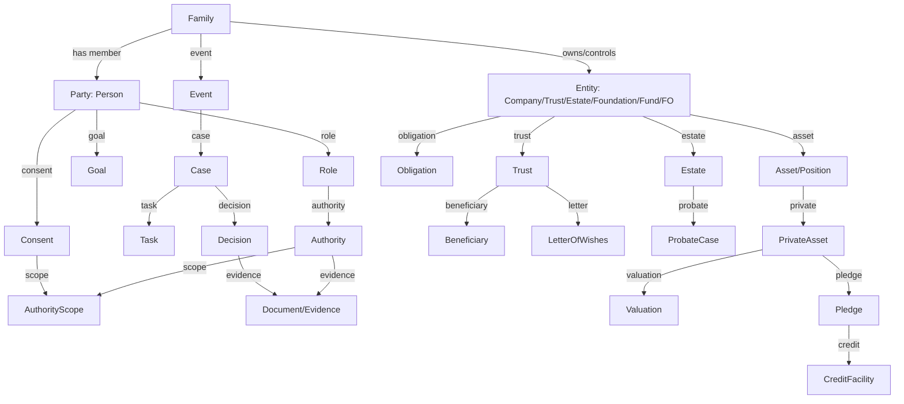

# 03 — 数据模型：家族、授权、事件、证据

> 目的：给产品/工程/数据一个可落地的对象模型；不是完整 DDL，而是“主键与关系”。
> 原则：**Party 是法律主体，Family 是服务视图，Role 是关系，Authority 是权利，Event 是变化，Evidence 是证明。**

---

## 1. 核心图



---

## 2. 十二组核心实体

### 2.1 家族与服务视图

| 实体 | 说明 | 关键字段 |
|---|---|---|
| `Family` | 服务视图；不是法律主体 | `family_id`、`name`、`branches`、`generations`、`status` |
| `Household` | 家庭服务视图；可与 Family 不同 | `household_id`、`members`、`address`、`service_tier` |
| `FamilyBranch` | 家族分支 | `branch_id`、`parent_family_id`、`name` |
| `FamilyMember` | 成员关系 | `family_id`、`party_id`、`role`、`since`、`status` |

> `Family`/`Household` 不能用于法律判断；法律主体永远是 `Party`/`Entity`/`Trust`/`Estate`。

### 2.2 法律主体

| 实体 | 说明 | 关键字段 |
|---|---|---|
| `Party` | 抽象主体 | `party_id`、`type`、`status`、`jurisdiction` |
| `Person` | 自然人 | `person_id`、`name`、`DOB`、`nationality`、`tax_residency`、`capacity_status` |
| `Company` | 公司 | `company_id`、`legal_form`、`registration`、`jurisdiction`、`ownership` |
| `Trust` | 信托 | `trust_id`、`deed`、`proper_law`、`settlor`、`trustee`、`protector`、`beneficiaries` |
| `Estate` | 遗产 | `estate_id`、`deceased`、`domicile`、`executor`、`assets`、`liabilities` |
| `Foundation` | 基金会 | `foundation_id`、`purpose`、`jurisdiction`、`council` |
| `Fund` | 基金 | `fund_id`、`GP`、`LP`、`strategy`、`NAV` |
| `FamilyOffice` | 家办 | `fo_id`、`type`、`jurisdiction`、`services`、`team` |

### 2.3 关系、所有权、控制

| 实体 | 说明 | 关键字段 |
|---|---|---|
| `Relationship` | 家庭/经济/服务/代表 | `rel_id`、`from`、`to`、`type`、`valid_from/to`、`source` |
| `Ownership` | 直接/间接持股 | `owner`、`owned`、`percentage`、`votes`、`effective_date` |
| `ControlRight` | 控制权 | `holder`、`subject`、`type`（vote/remove/appoint/veto）、`scope` |
| `BeneficialOwner` | 最终受益所有人 | `party`、`entity`、`basis`、`percentage`、`evidence` |
| `ProtectorPower` | 保护人权力 | `trust_id`、`protector`、`powers`、`consent_required` |

### 2.4 角色、授权、同意

| 实体 | 说明 | 关键字段 |
|---|---|---|
| `Role` | 角色 | `role_id`、`party`、`context`（family/entity/trust/estate）、`type` |
| `Authority` | 法律授权 | `authority_id`、`type`（POA/EPA/LPA/deputy/trustee/executor/mandate）、`grantor`、`grantee`、`status` |
| `AuthorityScope` | 授权范围 | `accounts/assets`、`actions`、`amount_limit`、`jurisdiction`、`purpose` |
| `AuthorityStatus` | 状态 | `draft/registered/active/suspended/revoked/expired` |
| `Consent` | 数据/服务同意 | `subject`、`grantee`、`purpose`、`fields`、`valid_from/to`、`revocable` |
| `Restriction` | 限制 | `type`（joint/overdraft/no-digital）、`scope`、`source` |
| `ConflictRegister` | 冲突 | `party`、`role`、`subject`、`type`、`mitigation`、`status` |

**授权不变量：**

1. 没有 `Authority`/`Consent` 不得支付/披露/交易（除非法律/法院/紧急规则）。
2. 死亡事件必须使 POA/第三方授权失效；executor 权限按 grant/法律。
3. 信托资产不是遗产；executor 不能自动取得信托资产。
4. `joint` 授权必须所有 attorney 一起；不能给单个 attorney 独立网银/借记卡（按银行政策）。
5. 授权范围/金额/辖区/时间必须显式；默认拒绝。
6. 法院命令 > POA/内部政策；制裁/冻结 > 客户指令。

### 2.5 目标、事件、旅程

| 实体 | 说明 | 关键字段 |
|---|---|---|
| `Goal` | 家族/成员目标 | `goal_id`、`type`、`owner`、`beneficiary`、`funder`、`decision_maker`、`target_amount`、`currency`、`target_date` |
| `LifeEvent` | 生命/财富事件 | `event_id`、`type`、`date`、`subjects`、`jurisdiction`、`source` |
| `Journey` | 旅程实例 | `journey_id`、`type`（S1–S5/X1–X5）、`status`、`owner` |
| `Milestone` | 里程碑 | `milestone_id`、`goal`、`date`、`status`、`evidence` |
| `Case` | 案件 | `case_id`、`type`、`subjects`、`status`、`owner`、`SLA` |
| `Task` | 任务 | `task_id`、`case`、`assignee`、`due`、`status` |

### 2.6 资产、私股、信贷

| 实体 | 说明 | 关键字段 |
|---|---|---|
| `Asset` | 资产 | `asset_id`、`type`、`owner`、`jurisdiction`、`value`、`valuation_date` |
| `Position` | 持仓 | `position_id`、`account`、`instrument`、`quantity`、`cost` |
| `PrivateAsset` | 私股/私企 | `private_asset_id`、`company`、`shares`、`round`、`lock_up`、`exit_path` |
| `Valuation` | 估值 | `valuation_id`、`method`、`value`、`date`、`discount`、`approver` |
| `Pledge` | 质押 | `pledge_id`、`asset`、`secured_party`、`registration`、`jurisdiction`、`status` |
| `CreditFacility` | 授信 | `facility_id`、`borrower`、`amount`、`currency`、`LTV`、`covenants` |
| `Covenant` | 契约 | `covenant_id`、`facility`、`test`、`frequency`、`status` |
| `MarginCall` | 追保 | `call_id`、`facility`、`trigger`、`amount`、`due`、`status` |
| `Obligation` | 义务 | `obligation_id`、`type`（capital call/earn-out/vendor loan/tax/interest）、`due`、`amount` |
| `ExitScenario` | 退出 | `scenario_id`、`type`（IPO/secondary/forward）、`proceeds`、`tax`、`control` |

### 2.7 信托、遗产、保险

| 实体 | 说明 | 关键字段 |
|---|---|---|
| `TrustDeed` | 信托契约 | `deed_id`、`trust`、`version`、`proper_law`、`powers` |
| `LetterOfWishes` | 意愿书 | `letter_id`、`trust`、`version`、`date`、`status`（draft/delivered/revoked/disputed） |
| `Beneficiary` | 受益人 | `beneficiary_id`、`trust/estate`、`party`、`class`、`interest` |
| `Will` | 遗嘱 | `will_id`、`testator`、`date`、`executor`、`status` |
| `ProbateCase` | probate | `probate_id`、`estate`、`jurisdiction`、`court`、`grant`、`status` |
| `EstateAccount` | 遗产账户 | `account_id`、`estate`、`executor`、`balance` |
| `Policy` | 保险 | `policy_id`、`owner`、`insured`、`beneficiary`、`type` |
| `CharitableTrust` | 慈善信托 | `charity_id`、`trust`、`purpose`、`grants` |

### 2.8 税务、跨境、合规

| 实体 | 说明 | 关键字段 |
|---|---|---|
| `TaxProfile` | 税务画像 | `tax_profile_id`、`party`、`residency`、`domicile`、`TIN`、`indicators` |
| `TaxResidency` | 居民状态 | `party`、`jurisdiction`、`from/to`、`basis`、`days` |
| `IncomeStream` | 收入流 | `income_id`、`type`、`source`、`payer`、`amount`、`currency` |
| `TaxLot` | 税务批次 | `lot_id`、`position`、`acquired`、`cost`、`quantity` |
| `Withholding` | 预扣 | `withholding_id`、`payment`、`tax_type`、`rate`、`amount` |
| `TaxPack` | 税包 | `pack_id`、`party`、`year`、`jurisdictions`、`fields`、`status` |
| `TaxReport` | 报告 | `report_id`、`type`（CRS/FATCA/1042-S/1099）、`period`、`status` |
| `Jurisdiction` | 辖区 | `jurisdiction_id`、`country`、`legal_system`、`tax_system` |
| `PEPStatus` | PEP | `party`、`status`、`source`、`review_date` |
| `SanctionsHit` | 制裁 | `party`、`list`、`score`、`status` |
| `RemediationCase` | 历史补救 | `case_id`、`party`、`period`、`issue`、`status` |

### 2.9 文档、证据、决策

| 实体 | 说明 | 关键字段 |
|---|---|---|
| `Document` | 文件 | `doc_id`、`type`、`version`、`source`、`hash`、`retention` |
| `Evidence` | 证据 | `evidence_id`、`type`、`document`、`fact`、`grade`（E0–E3） |
| `Decision` | 决策 | `decision_id`、`case`、`subject`、`decision`、`rationale`、`approver`、`date` |
| `Approval` | 批准 | `approval_id`、`decision`、`role`、`status` |
| `Audit` | 审计 | `audit_id`、`actor`、`action`、`object`、`before/after`、`timestamp` |
| `Communication` | 沟通 | `comm_id`、`subject`、`recipient`、`channel`、`content_ref`、`consent` |

### 2.10 服务、生态、渠道

| 实体 | 说明 | 关键字段 |
|---|---|---|
| `ServiceCatalog` | 服务目录 | `service_id`、`type`、`provider`、`price`、`eligibility` |
| `ServiceRequest` | 服务请求 | `request_id`、`family`、`service`、`status`、`owner` |
| `Invitation` | 邀请 | `invitation_id`、`family`、`program`、`invitee`、`consent`、`status` |
| `Partner` | 伙伴 | `partner_id`、`type`、`jurisdiction`、`contract`、`SLA` |
| `Referral` | 转介 | `referral_id`、`client`、`partner`、`status`、`outcome` |
| `Channel` | 渠道 | `channel_id`、`type`（RM/portal/app）、`role`、`permissions` |

### 2.11 商业与衡量

| 实体 | 说明 | 关键字段 |
|---|---|---|
| `FamilyValue` | 家族价值 | `family_id`、`revenue`、`AUM/AUA`、`wallet_share`、`next_gen_activation`、`retention` |
| `Revenue` | 收入 | `family`、`product`、`amount`、`period` |
| `ReferralValue` | 转介价值 | `family`、`source`、`converted`、`value` |
| `CostToServe` | 服务成本 | `family`、`service`、`hours`、`cost` |

---

## 3. 事件与证据模型

### 3.1 事件类型

| 类别 | 事件 |
|---|---|
| 生命 | birth、education、marriage、divorce、relocation、death、incapacity |
| 财富 | business_start、financing、IPO、exit、dividend、inheritance、philanthropy |
| 资产 | trade、payment、transfer、pledge、margin_call、capital_call、distribution |
| 法律 | trust_setup、will_update、probate、court_order、sanctions |
| 关系 | onboarding、role_change、consent_change、complaint |
| 风险 | fraud、dispute、tax_remediation、regulatory_request |

### 3.2 事件信封

```json
{
  "event_id": "evt_...",
  "type": "death|incapacity|ipo|relocation|trade|...",
  "occurred_at": "2026-10-26T10:00:00Z",
  "effective_at": "2026-10-26",
  "jurisdiction": "HK",
  "subjects": ["party_1", "trust_2"],
  "source": "client|bank|court|advisor|system",
  "evidence_ids": ["doc_1", "doc_2"],
  "payload": {},
  "as_of": "2026-10-26",
  "version": 1
}
```

### 3.3 证据等级

| 等级 | 含义 | 例子 |
|---|---|---|
| **E0** | 口头/未验证 | RM 电话、客户口述 |
| **E1** | 文件 | 扫描件、邮件 |
| **E2** | 可验证文件 | 公证/认证/登记/银行流水 |
| **E3** | 法院/监管可采信 | 法院命令、grant、监管批复 |

### 3.4 决策记录

`Decision` 必须回答：

- 谁提出？谁批准？谁反对？
- 依据哪份文件/数据/法律意见？
- 有没有冲突？如何隔离？
- 客户/受益人是否被告知？何时/如何？
- 结果是什么？谁执行？何时？

---

## 4. As-of 与双时态

每个关键对象至少两个时间：

- `valid_from`/`valid_to`：法律/业务有效期；
- `recorded_at`：系统记录时间。

查询示例：

> “2026-10-25 死亡当天，谁有权操作香港账户？”
> → 取 `DeathEvent.effective_at <= 2026-10-25`；POA `status=revoked`；executor `grant_date`；信托 trustee 权限不受影响。

> “2026-09-30 这笔私股估值是多少？谁批准的？”
> → 取 `Valuation.valid_from <= 2026-09-30` + `approval` + `evidence`。

---

## 5. 与 Avaloq 的迁移映射（参考，不是目标依赖）

> 目标状态是自研核心；Avaloq 只用于需求对照与历史数据迁移翻译，不再作为运行时平台。

| 新对象 | Avaloq 参考对象 | 说明 |
|---|---|---|
| `Party`/`Person`/`Company` | `OBJ_BP`/`OBJ_PERSON` | 主数据；新核心补充 family/role/UBO |
| `Contract`/`Account` | `OBJ_CONT` | 合同/账户 |
| `Position`/`Trade`/`Cash` | `POS`/`DOC_STEX`/`DOC_SETTLE` | 持仓/交易/支付 |
| `CreditFacility`/`Collateral` | `LIHI`/`COLLAT` | 额度/抵押 |
| `Withholding` | `TAX2_EVT` | 交易税/预扣 |
| `Document` | `DOC` | 文件；新核心补证据等级 |
| `Task` | `TASK_*`/`WFC` | 任务/审批；新核心补法律事件 |
| `Relationship` | `OBJ_PERSON_REL2` | 关系；新核心补 family/UBO/authority |
| `Authority` | `OBJ_BP_PERS_REL_AUTH` 字段 | 只作输入；新核心是事实源 |

**原则：**

- 目标状态：自研新核心独立持有持仓/交易/会计/家族/授权/证据；不运行时依赖 Avaloq。
- 迁移期间：Avaloq 数据只作对照/翻译；迁移完成后不续订、不双写。
- 自研账本为准（金额/持仓/会计）；自研授权图谱为准（谁有权/依据）。
- 所有跨模块写入带 `idempotency_key`/`event_id`/`as_of`；历史迁移带 `source_system`/`source_id`/`migration_batch`。

---

## 6. 关键不变量（工程必须写进测试）

1. 无 `Authority`/`Consent` 不得支付/披露/交易（除法律/法院/紧急规则）。
2. `DeathEvent` 必须使 POA/第三方授权失效；executor 权限按 grant。
3. 信托资产不是遗产；`Estate` 与 `Trust` 分离。
4. `joint` 授权必须 all attorneys；限制 `debit/internet/mobile/telephone`。
5. `restriction` 优先于 `authority`；法院命令/制裁优先于客户指令。
6. `TaxPack` 不包含未授权行外数据；来源/责任/证据必须标注。
7. `PrivateAsset` 估值必须有方法/日期/审批；无估值不得质押/放款。
8. `Pledge` 未登记/未获公司同意不得视为可执行。
9. `Beneficiary` 不是 `Payee`/`Taxpayer`/`UBO`；不得混用。
10. 任何 AI 输出必须标注模型/提示词/数据/人工复核；不得签字/下单/披露。

---

## 7. 数据治理

| 主题 | 规则 |
|---|---|
| **数据质量** | 完整/一致/及时/可追溯；关键字段必填 |
| **数据 lineage** | 每个数字可下钻到源系统/文件/时间 |
| **权限** | 角色/字段/目的/辖区；最小权限 |
| **保留** | 法律/监管/合同；可删除/可审计 |
| **跨境** | 数据驻留/传输协议/DPIA |
| **AI** | 只读授权字段；PII 脱敏；模型/提示词版本 |
| **供应商** | 合同/审计/退出/数据 ownership |

---

## 8. 一句话

> **家族是图，不是表；授权是权利，不是字段；事件是变化，不是日志；证据是证明，不是 PDF。**
