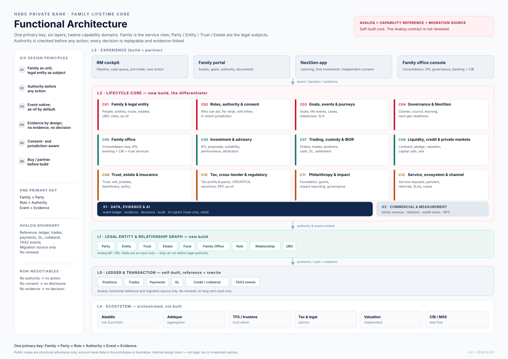

# 02 — 新核心架构：Family Lifetime Core

> 一句话：**以 Avaloq 为能力参考，重写为自有核心；新核心同时做“账”和“家族、授权、事件、证据、代际关系”；不续订 Avaloq。**
> 这一版不是“18 个模块的堆叠”，而是“一个主键 + 六层能力 + 十二个能力域”。

---

## 0. 功能架构图（先看这张）

> **目录导航（5 份文档）：**
>
> | 文档 | 回答什么 |
> |---|---|
> | **README.md** | 一主键 / 六层 / 十二域；系统版图；NFR；v1.3 对照 |
> | [`01-capability-and-data-model.md`](01-capability-and-data-model.md) | C01–C12 + X1/X2 能力模型；实体/事件/证据/不变量 |
> | [`02-avaloq-boundary-and-business-case.md`](02-avaloq-boundary-and-business-case.md) | Avaloq 强项/弱项；为什么替换、替换什么、迁移/闸门 |
> | [`03-solution-map.md`](03-solution-map.md) | 能力→模块→页面；五个新思路验证；21 页 Workbench |
> | [`04-rm-tax-guide.md`](04-rm-tax-guide.md) | RM 税务导航：能说/不能说、六问、伙伴转介 |
>
> 视频实际 demo 的旅程表在 [`../01-user-journey/00-journey-catalog.md`](../01-user-journey/00-journey-catalog.md)。



- 可缩放/可打印版本：[`functional-architecture.html`](functional-architecture.html)
- 矢量源文件：[`functional-architecture.svg`](functional-architecture.svg)

**怎么读这张图：**

1. 从上到下是 **体验（L3）→ 生命周期核心（L2）→ 法律主体（L1）→ 账本（L0）**，不是技术栈，而是责任边界。
2. **L2 是新核心的差异化**：C01–C04 家族与授权、C05–C08 财富与流动性、C09–C12 保护与服务；任何动作先过 **C02 授权与同意**。
3. **X1 数据/证据/AI** 横贯所有能力域：事件账本、证据、决策、审计；AI 只读、必须引用。
4. **L0 是自研重写层**：Avaloq 只作能力参考与迁移来源，**不续订**；不是长期双核。
5. 外部生态（Aladdin、Addepar、TFS、税务/法律、估值、CIB/MSS）是编排，不是自建。

> 这张图是 v2.1 的当前架构图。旧版 v1.3 的 7 层 / 18 模块图仍可在 [`archive/2026-10_v1/02_architecture/nextgen-pb-demand-driven-architecture-en.html`](../archive/2026-10_v1/02_architecture/nextgen-pb-demand-driven-architecture-en.html) 查阅；两者的对应关系见 §7.1。

---

## 1. 先纠正三个旧判断

| 旧判断 | 问题 | 新判断 |
|---|---|---|
| “Avaloq 必须被平替” | 把“客户生命周期核心”与“交易/账本核心”混为一谈；忽略 Avaloq 的 DOC/WFC/TASK、BP/REL、TAX2、COLLAT、AFS 强项 | **目标：参考 Avaloq 能力，自研重写 L0–L2；不续订 Avaloq** |
| “Avaloq 没有税务能力” | TAX2 是真实的事件税计算/预扣；只是不做全球个人报税/行外收入 | **Avaloq 有交易税/预扣；没有“个人税务数据包/全球申报”** |
| “Avaloq 没有工作流/客户生命周期” | Avaloq 有 DOC/WFC/TASK/CLT，且占代码 58.4% | **它有“单据/任务/客户生命周期”，但没有“法律事件/授权/证据”的生命周期** |

---

## 2. 分层

| 层 | 内容 | 谁做 | 判定 |
|---|---|---|---|
| **L0 交易与账本** | 持仓、现金、交易、结算、会计、支付、托管、信贷余额、抵押、交易税/预扣 | **自研新核心** | 参考 Avaloq 能力，重写；不续订 |
| **L1 家族与法律主体** | 人、公司、信托、遗产、基金、家办、受益所有人、控制权、角色、授权、同意 | **新核心** | 新建 |
| **L2 生命周期编排** | 目标、事件、案件、任务、文件、决策、证据、跨境、私股生命周期 | **新核心** | 新建 |
| **L3 体验与智能** | RM cockpit、家族 portal、下一代 app、家办 dashboard、AI | **新核心 + 合作** | 新建/合作 |
| **L4 生态** | MIT、律师、税务、信托、估值、CIB、Innovation Banking | **合作/编排** | 合作 |
| **X 横向域** | 数据、证据、AI；商业衡量、客户价值 | **新核心** | 横贯所有层 |

> “Core banking”在这里不是“ledger 的同义词”，而是**客户生命周期的事实源 + 交易账本 + 证据底座**。

---

## 3. 六个设计原则

1. **Family as the unit, legal entity as the subject.** `Family` 是服务视图；`Party`/`Trust`/`Estate`/`Company` 是法律主体；不要用一个 `client_id` 代表全部。
2. **Authority before action.** 任何支付/披露/交易/分配，先回答“谁有权、依据什么、到何时、在哪个辖区”。
3. **Event-native, as-of by default.** 死亡、失能、IPO、搬迁、离婚、制裁、交易、分配都是事件；任一历史时点可重放。
4. **Evidence by design.** 决策、同意、披露、批准、送达、支付，全部可审计；不是 PDF 归档。
5. **Consent-aware, jurisdiction-aware.** 家族成员/跨境/未成年人/健康数据，按目的/角色/辖区最小化。
6. **Buy/partner before build.** 风险分析（Aladdin）、聚合（Addepar）、税务申报、法律、估值、信托行政，优先合作；不建通用 AI/聊天机器人。

---

## 4. 十二个能力域

| # | 能力域 | 回答的问题 | 关键对象 | 主要系统 |
|---|---|---|---|---|
| **C01** | 家族与法律主体 | 这个家族有哪些人/公司/信托/遗产/家办？ | `Family`/`Party`/`Entity`/`Trust`/`Estate`/`FamilyOffice` | 新核心 |
| **C02** | 角色、授权与同意 | 谁现在能做什么、依据什么、到何时？ | `Role`/`Authority`/`Consent`/`Restriction` | 新核心 |
| **C03** | 目标、事件与旅程 | 这个家族下一步要做什么？ | `Goal`/`LifeEvent`/`Journey`/`Milestone` | 新核心 |
| **C04** | 家族治理与下一代 | 家族怎么一起做决定、下一代怎么准备？ | `FamilyCharter`/`Council`/`NextGenPlan`/`LearningRecord` | 新核心 |
| **C05** | 家族办公室 | 家办怎么运营、合并、投资、治理？ | `FamilyOffice`/`ConsolidatedView`/`InvestmentPolicy` | 新核心 + 合作 |
| **C06** | 投资与顾问 | 目标怎么变成组合/提案/建议？ | `IPS`/`Portfolio`/`Proposal`/`Suitability` | 自研新核心 + Aladdin |
| **C07** | 交易、托管与账本 | 怎么下单/结算/托管/记账？ | `Order`/`Trade`/`Position`/`Cash`/`GL` | 自研新核心（参考 Avaloq 能力） |
| **C08** | 流动性、信贷与私股 | 不卖资产怎么拿钱？私股怎么估值/质押/退出？ | `CreditFacility`/`Pledge`/`PrivateAsset`/`Valuation`/`Exit` | 自研新核心 + 合作 |
| **C09** | 信托、遗产与保险 | 怎么传承、保护、分配？ | `Trust`/`Will`/`Estate`/`Probate`/`Policy` | TFS/合作 + 新核心 |
| **C10** | 税务、跨境与监管 | 在哪交税、谁报、CRS/FATCA、制裁/PEP？ | `TaxProfile`/`TaxLot`/`TaxPack`/`Jurisdiction`/`Screen` | 自研新核心（参考 Avaloq TAX2）+ 合作 |
| **C11** | 慈善与影响力 | 怎么给、给谁、效果如何？ | `Foundation`/`Grant`/`Impact` | TFS/合作 + 新核心 |
| **C12** | 服务、生态与渠道 | 谁交付、怎么交付、体验如何？ | `ServiceRequest`/`Partner`/`Case`/`Channel` | 新核心 |
| **X1** | 数据、证据与 AI | 数据从哪来、证据怎么存、AI 怎么用？ | `Event`/`Evidence`/`Decision`/`Audit`/`Model` | 新核心 |
| **X2** | 商业与衡量 | 家族层收入/留存/钱包份额？ | `FamilyValue`/`Revenue`/`Retention`/`Referral` | 新核心 + 财务 |

---

## 5. 系统版图

```
┌──────────────────────────────────────────────────────────────┐
│ L3 体验：RM Cockpit │ Family Portal │ NextGen App │ FO Dashboard │
├──────────────────────────────────────────────────────────────┤
│ L2 家族生命周期核心（新）                                      │
│  Family/Entity Graph │ Authority/Consent │ Goals/Events       │
│  Governance/NextGen │ Family Office │ Private Asset │ Evidence│
├──────────────────────────────────────────────────────────────┤
│ L1 客户/法律主体/关系（自研；Avaloq 仅迁移映射）                │
├──────────────────────────────────────────────────────────────┤
│ L0 交易与账本（自研新核心；Avaloq 仅参考）                      │
│  Positions │ Trades │ Payments │ GL │ Credit/Collateral │ TAX2│
├──────────────────────────────────────────────────────────────┤
│ 外部：Aladdin │ Addepar │ TFS/Trust │ Tax/Law │ Valuation │ CIB│
└──────────────────────────────────────────────────────────────┘
```

**集成原则：**

- 自研新核心重写持仓/交易/会计；Avaloq 仅作迁移期间的数据对照。
- Avaloq 不承担家族/授权/证据；自研新核心是事实源。
- 所有跨系统事件带 `event_id`/`as_of`/`evidence_id`；可重放。
- 客户/家族数据按 consent/辖区最小化；AI 只读授权字段。

---

## 6. 什么必须新建，什么必须保留

### 6.1 新建（差异化）

- `Family`/`EntityGraph`/`Role`/`Authority`/`Consent`；
- `Goal`/`LifeEvent`/`Journey`；
- `FamilyCharter`/`Council`/`NextGenPlan`/`LearningRecord`；
- `FamilyOffice`/`ConsolidatedView`；
- `PrivateAsset`/`Valuation`/`Pledge`/`Obligation`/`Exit`；
- `EstateCase`/`ProbateCase`/`TrustCase`/`Beneficiary`/`LetterOfWishes`；
- `TaxPack`/`TaxProfile`/`TaxLot`（跨实体/行外）；
- `Evidence`/`Decision`/`Audit`/`ConflictRegister`；
- `Partner`/`ServiceRequest`/`Referral`/`SLA`。

### 6.2 参考/重写（Avaloq），不续订

- 账户/合同/持仓/交易/结算/支付/会计；
- 信贷/抵押/额度/追保/COLLAT/LIHI；
- TAX2 交易税/预扣；CRS/FATCA 报告；
- DOC/WFC/TASK/CLT；AFS 前台；
- BP/PERSON/CONT/关系/授权字段（作为输入，不作为法律授权算法）。

### 6.3 不建（合作/买）

- 风险分析/组合优化：Aladdin；
- 全量 held-away 聚合：Addepar/合作；
- 法律/税务意见：外部律师/税务；
- 信托行政/遗产认证：TFS/当地信托公司/律师；
- 估值判断：独立估值师/委员会；
- 通用 AI 底座：买平台；
- 大众市场 onboarding/加密：暂不。

---

## 7. 非功能要求

| 要求 | 说明 |
|---|---|
| **As-of/时点** | 任一日期可回答“谁有权/什么有效/资产在哪” |
| **多实体/多辖区** | 同一家族跨 HK/SG/UK/CH/UAE/US；法律主体/税务/数据驻留分开 |
| **Consent-aware** | 角色/字段/目的/辖区/时间；可撤回 |
| **Evidence-grade** | 决策/同意/披露/支付可审计；不可篡改 |
| **API-first** | 与 Aladdin/Addepar/TFS/税务/估值/CIB；Avaloq 仅在迁移期做数据对照 |
| **Configurable** | 规则/产品/辖区/权限可配置；版本化 |
| **Resilient** | 关键事件/支付/证据高可用；灾备 |
| **Explainable** | AI/规则输出可解释；人签字 |
| **Secure** | 加密/令牌化/最小权限/Chinese Wall |
| **Observable** | 事件/延迟/错误/数据质量可监控 |

---

### 7.1 与 v1.3 的 7 层 / 18 模块对照（能力没有丢）

| v1.3 旧模块 | v2.1 能力域 | 说明 |
|---|---|---|
| M01 客户/家族主数据 | **C01** 家族与法律主体 | 主数据升级为“人—家族—实体—角色—关系”图 |
| M02 家族图谱与治理 | **C04** 家族治理与下一代 | 章程、委员会、下一代计划 |
| M03 同意/授权/争议 | **C02** 角色、授权与同意 | 从字段升级为“动作前检查” |
| M04 实体与结构图 / M05 所有权与权利 | **C01** 家族与法律主体 | 信托/公司/SPV/受益所有人/控制权 |
| M06 私股与 Pre-IPO / M07 资产台账 / M10 信贷与流动性 | **C08** 流动性、信贷与私股 | 估值—质押—资本调用—退出全周期 |
| M08 组合与 IBOR / M09 交易执行 / M11 支付与 FX | **C07** 交易、托管与账本 | 自研重写；参考 Avaloq 领域模型 |
| M12 多辖区身份 / M13 税务计算 / M14 义务与披露 | **C10** 税务、跨境与监管 | TAX2 只覆盖系统内交易税/预扣；全球数据包与合作 |
| M15 案件与工作流 | **C03** 目标、事件与旅程 + **C12** 服务与生态 | 案件不是工单，是生命周期对象 |
| M16 文档/合同/证据 / M17 数据平台 / M18 AI Copilot | **X1** 数据、证据与 AI | 证据一等对象；AI 只读且可追溯 |
| X1–X4 体验（客户端/RM/家办/外部顾问） | **L3 体验层** | 四类入口保留，统一到同一主键 |

**结论：** 旧图的 18 个模块被归并为 12 个能力域 + 2 个横向域；没有能力被删除，变化的是**主键与责任边界**。旧图不再作为实现依据，但作为能力完整性检查表保留。

---

## 8. 往下读

- 能力模型 + 数据模型：[`01-capability-and-data-model.md`](01-capability-and-data-model.md)
- Avaloq 边界 + 替换商业论证：[`02-avaloq-boundary-and-business-case.md`](02-avaloq-boundary-and-business-case.md)
- 解决方案层（模块映射 / Workbench / 五个新思路验证）：[`03-solution-map.md`](03-solution-map.md)
- RM 税务指引：[`04-rm-tax-guide.md`](04-rm-tax-guide.md)
- **视频 demo 旅程总表**：[`../01-user-journey/00-journey-catalog.md`](../01-user-journey/00-journey-catalog.md)
- 旅程、蓝图、场景：[`../01-user-journey/README.md`](../01-user-journey/README.md)
- 34 客户路由 + 21 工作台页面：[`../01-user-journey/PAGE-MAP.md`](../01-user-journey/PAGE-MAP.md)
